# Rooted walkthrough

Recorded from the production web build with demo data. Regenerate with `npm run build:web && npm run walkthrough`.

**Full video:** [0-full-walkthrough.mp4](0-full-walkthrough.mp4)

| Point of view | Video |
|---|---|
| The core loop | [1-parent.mp4](1-parent.mp4) |
| Sunday planning and Grow | [2-week.mp4](2-week.mp4) |
| A new parent, from zero | [3-new-parent.mp4](3-new-parent.mp4) |

## The core loop

_Parent · Maya_ · [video](1-parent.mp4)

### 1. Install it from Safari or Chrome

No app store. iPhone: Share → Add to Home Screen. Android or desktop Chrome: Install. It opens full screen and works offline.

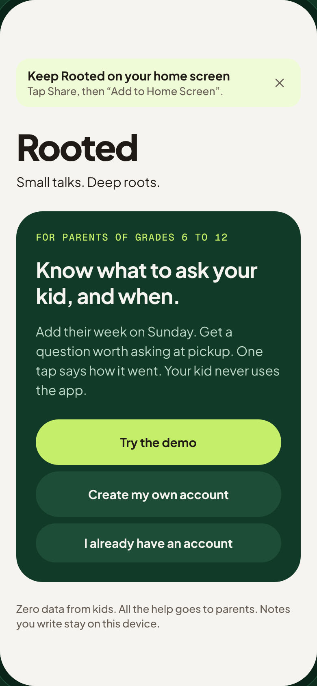

### 2. Parents only

Kids never use Rooted and have no account. The parent signs in with email and password; the demo opens an example family.

### 3. Tonight’s starter

Ava has a math test tomorrow, so tonight’s question is about the test: “What part of Math test feels most ready?”, with a tip on how to ask it in the car.

### 4. Try another

Every question comes from a library a person on the team reviewed. Rooted picks among them; nothing is generated on the fly.

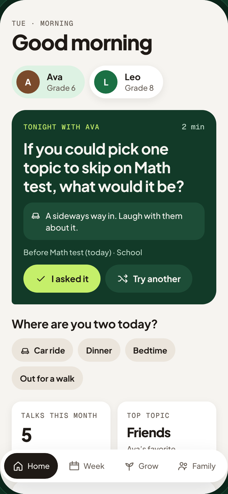

### 5. Where are you two tonight?

Car ride, dinner, bedtime, a walk. The moment is logged with the talk so the team learns where questions land.

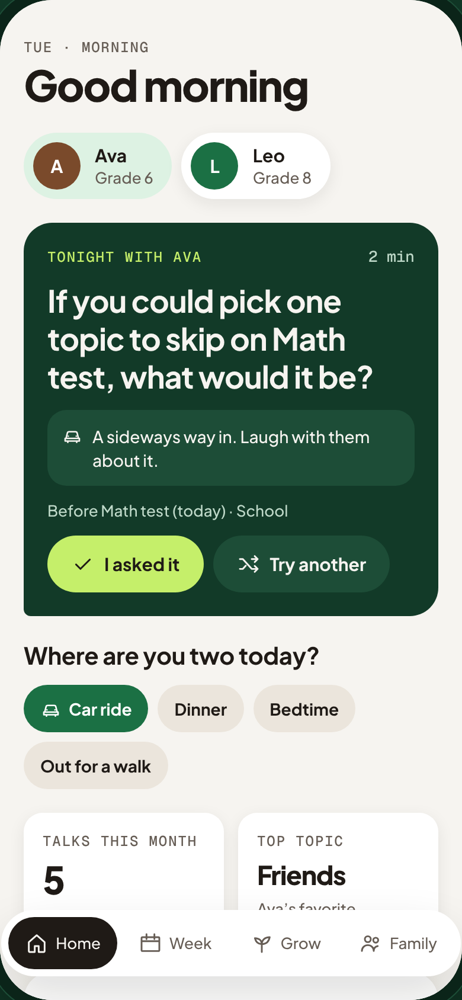

### 6. I asked it

One tap at pickup. Then the phone goes away.

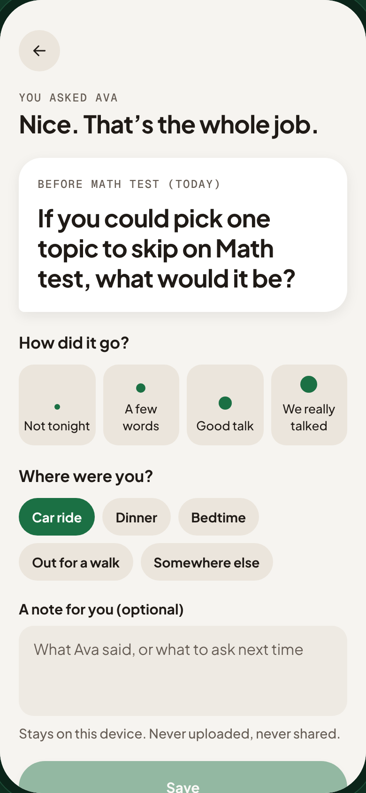

### 7. How did it go?

Four seeds, from “Not tonight” to “We really talked”. “Not tonight” is a valid answer; nothing is scored.

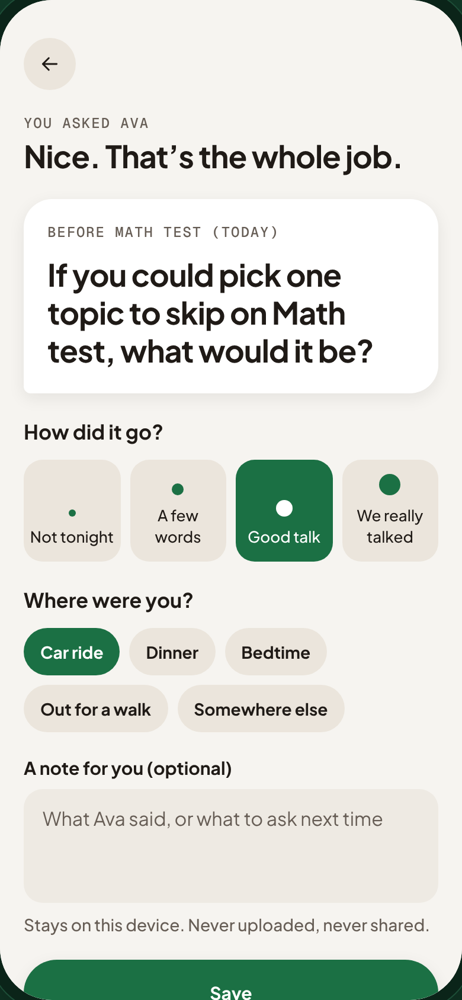

### 8. A note for you

What Ava said, or what to ask next time. Notes stay on this device. They are never uploaded.

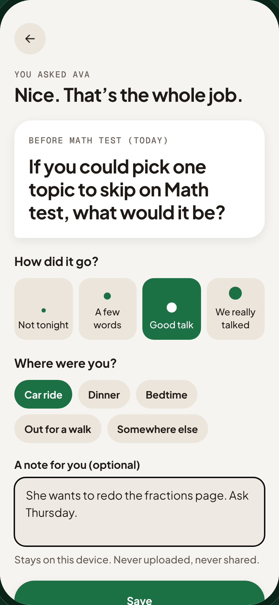

### 9. The week updates

Back home: one more talk this week. Counts, not streaks. The design system calls this “invite, never grade”.

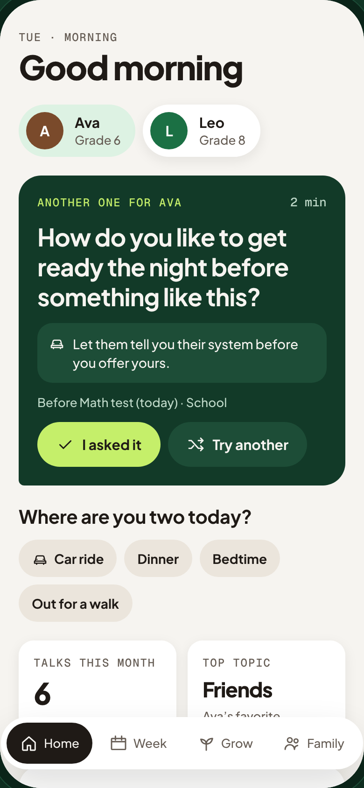

### 10. Two kids

Leo is in 8th grade. Switch kids and the starter follows: his robotics showcase is this week.

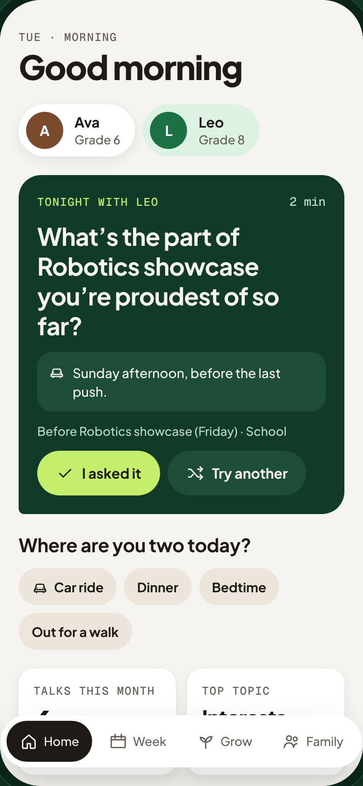

## Sunday planning and Grow

_Sunday planning_ · [video](2-week.mp4)

### 1. The week

Everything the parent entered: a math test, a soccer game, a showcase, a dance. Two weeks at a glance.

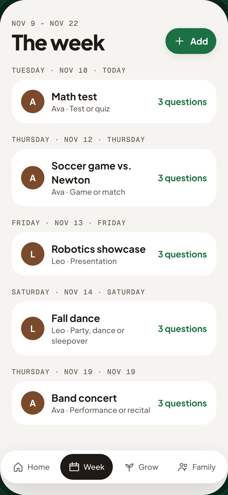

### 2. Three questions per event

Tap an event: three questions for before it happens, and three different ones for after.

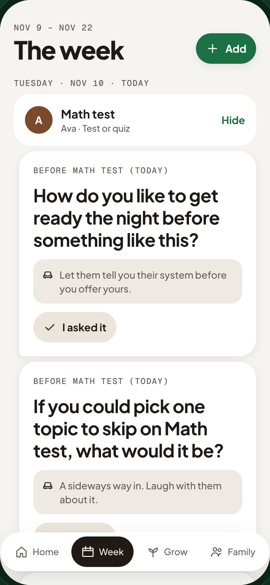

### 3. Add to the week

What is it, what kind, and when. That’s the whole Sunday check-in.

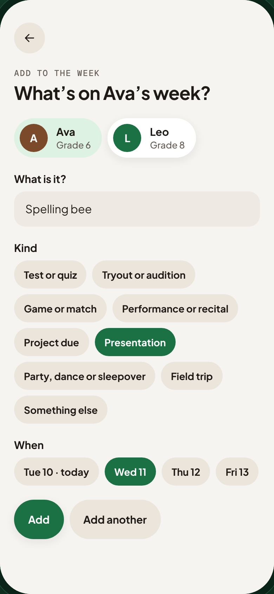

### 4. On the calendar

The new event has its questions immediately, and tonight’s starter will pick it up.

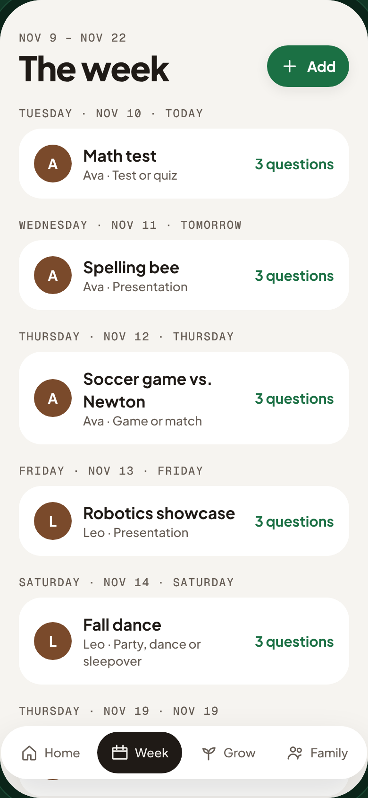

### 5. Grow: what happened this week

Talks this month, weeks with a talk, the topic that landed best. Never a score on the relationship, never a comparison with other families.

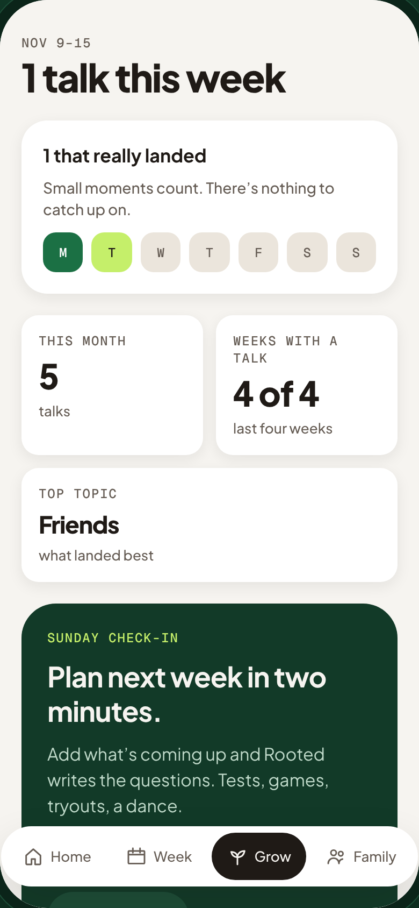

### 6. Which questions worked

Family feedback becomes the team’s signal: this is what we would learn from the pilot.

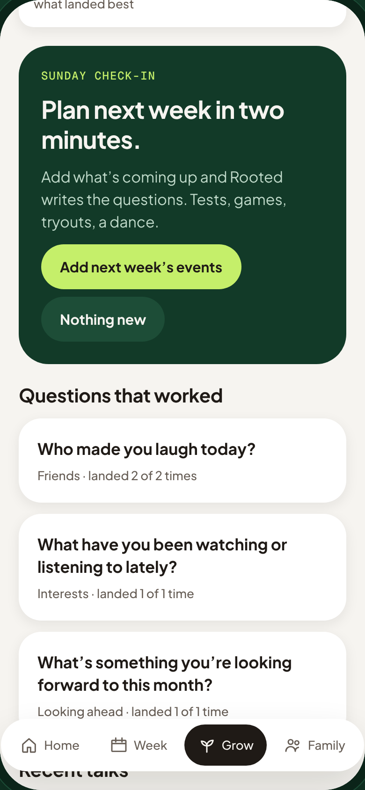

### 7. Your notes

Recent talks with the parent’s own notes, read from this device only.

### 8. Family: what Rooted knows

A first name, a grade, interests and the events you type. Nothing from the kid, ever. Delete everything in one tap.

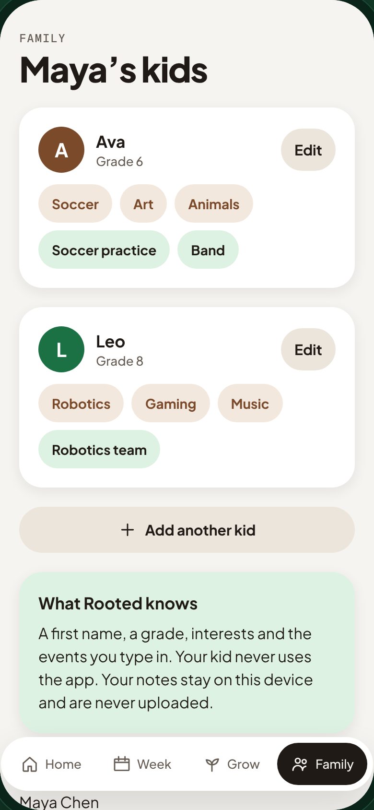

## A new parent, from zero

_New parent · Jordan_ · [video](3-new-parent.mp4)

### 1. Create an account

Email and password. Thirty seconds. No app store, no invitation, nothing sent to the kid.

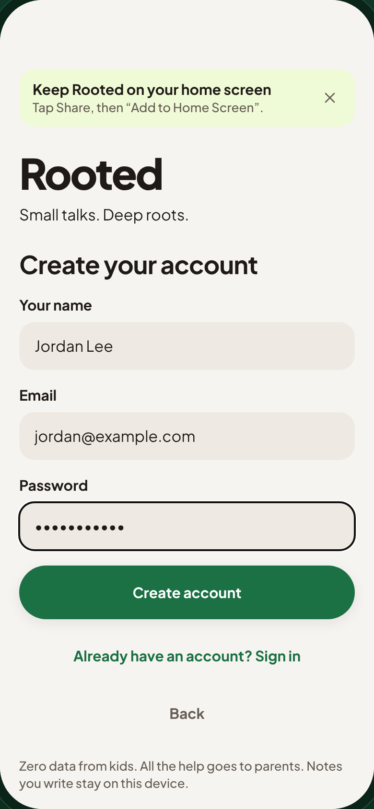

### 2. Two minutes to set up

Tell us about your kid, then what’s on their week.

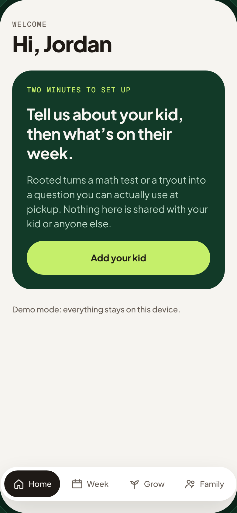

### 3. Step 1: the kid

First name, grade, a few interests. Starters use the name.

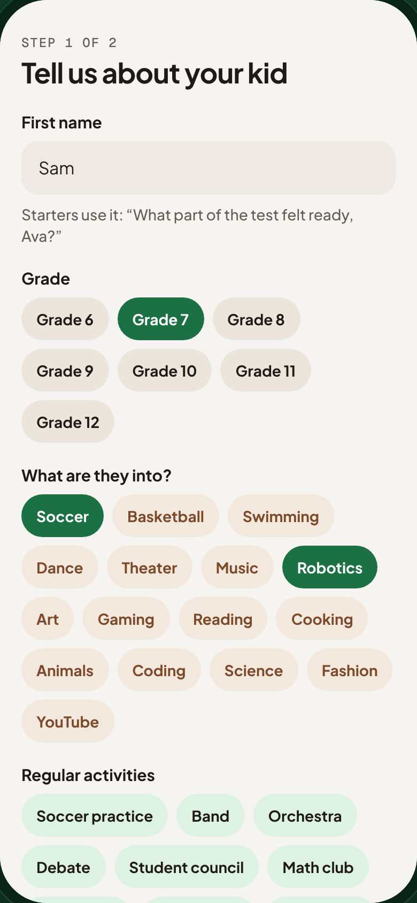

### 4. Step 2: the week

A soccer tryout on Thursday.

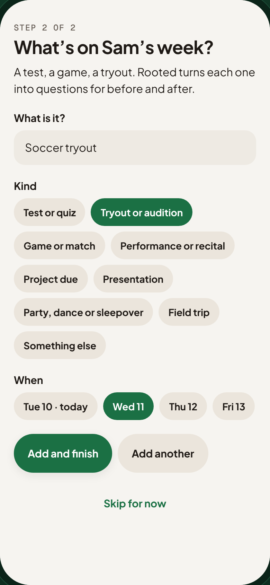

### 5. Tonight with Sam

The first starter is about the tryout: “What are you hoping the coach notices?” Ready for the car ride home.

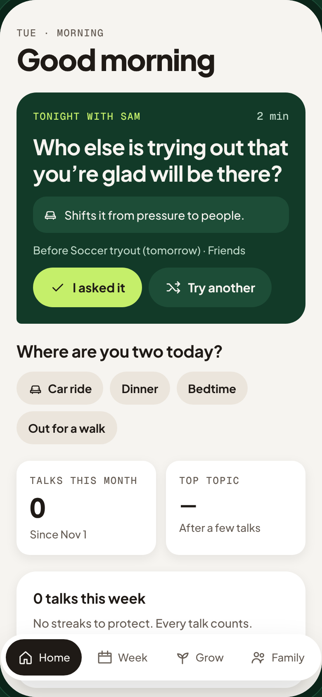

